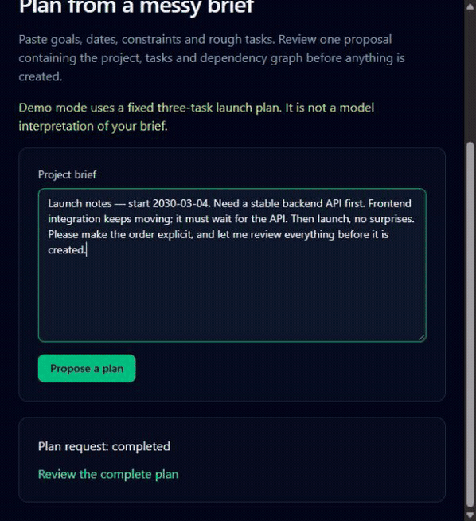
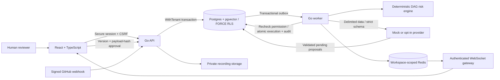

# Slipgraph

**Turn team updates into reviewable launch decisions.**

Slipgraph brings projects, dependency graphs, chat, meetings and cited workspace
search together. When someone says **“backend API will slip 3 days”**, it traces
the downstream schedule, explains the launch risk, and proposes date changes for
a human to review. The risk engine is deterministic; model output has no direct
business-write tools.



*Actual UI states captured from the local deterministic demo, with time compressed.
Mock providers use fixed fixtures; this is a developer showcase, not a production
security certification or a claim of general model reasoning.*

## Run the showcase

Requirements: Docker + Compose v2, Python 3.11+, GNU Make. No model API keys needed.

```sh
make seed        # start explicit mock profile; create/resume fictional showcase data
make demo        # seed, then execute and assert the complete story
```

Open [Slipgraph](http://localhost:5173). Local, randomly generated sign-in details
are in **`.showcase/credentials.json`**. That directory is Git-ignored and restricted
to the local user (and SYSTEM on Windows); never share the credentials file.
`PUBLIC_ORIGIN` can select another loopback port. Seeding remote hosts is refused.

The seed contains:

- **Meridian Launch:** 60 tasks across six workstreams, 63 dependencies converging
  on the public launch milestone, two channels, a sample meeting and timestamped
  transcript. The two-second silent recording and transcript are labeled mock fixtures.
- **Northstar Research:** a separate identity and workspace with private pilot data.
  That user has no membership in Meridian.

Seeding uses the normal authenticated APIs, CSRF, policy and runtime RLS. It resumes
existing fixtures and never deletes user data. Requests are paced within production
rate limits. The overlay changes the local stack to mock LLM/transcription/embedding
providers with bounded demo budgets; it retains existing volumes. Use ordinary
Compose startup to return to your configured provider modes.

The scripted story is **messy brief → pending plan → human approval → chat delay →
three-task impact → reviewed reschedules → audit-chain verification → cited Ask →
cross-workspace denial**. It uses a separate three-task project in Meridian because
the fixed mock plan is deliberately small. The 60-task launch remains available
for exploring the board and dependency timeline. Every run asserts that pending
proposals leave dates unchanged and that execution advances each task exactly once.

Sanitized evidence is recorded in [SHOWCASE_RESULT.json](docs/SHOWCASE_RESULT.json).
Live IDs, credentials and intermediate captures remain local in `.showcase/`.
For a presentation runbook and recording steps, see [SHOWCASE.md](docs/SHOWCASE.md).

## Ordinary Docker startup

```sh
docker compose up --build
# Or: make up       (background startup with health checks)
#     make down     (stop, preserving named volumes)
```

- Web: [localhost:5173](http://localhost:5173)
- API: [localhost:8080/healthz](http://localhost:8080/healthz)
- Same-origin API: [localhost:5173/api/healthz](http://localhost:5173/api/healthz)

No `.env` or hand-written passwords are needed. Startup generates random database,
Redis and auth credentials in named volumes, bootstraps roles/extensions and runs
owner-only migrations. Optional configuration is documented in `.env.example`.
Providers are disabled by default; the explicit showcase overlay enables fixtures.

Keep data and credential volumes together. Removing only the credential volumes
breaks database authentication. Local ports bind to loopback. Production needs
HTTPS, managed secrets, database/Redis TLS and operational controls described in
the threat model; the local Compose profile does not provide them.

## What is implemented

Projects with Kanban, tables and dependency-arrow timelines; task versions and soft
delete; cycle prevention; critical path, float and downstream risk; workspace chat,
threads, mentions, presence and reconnect; immutable briefs and reviewed proposals;
private meeting uploads, searchable evidence and click-to-seek; hybrid search and
cited answers; GitHub PR signals; append-only, hash-chained audit verification.

A real provider is opt-in. Model requests use strict schemas and untrusted-data
blocks, with shared quotas, caps, deadlines and bounded retries. The mock plan has
three fixed tasks, mock embeddings hash words, and mock Ask quotes retrieved text.
Calendar durations use UTC and 24-hour days, not working calendars or resource leveling.
Comments remain a placeholder. Public recovery email, SSO and billing are not enabled.

## Architecture



One Go module, separate API and worker processes, domain packages under `internal/`,
and a generated OpenAPI client. Durable business state stays in Postgres; Redis
presence/fanout is transient. Slow model, transcription and embedding work belongs
in authorized worker jobs. [Architecture details](docs/ARCHITECTURE.md).

## The nine foundations

1. **Tenant RLS:** session-derived workspace identity, ENABLE + FORCE RLS, composite
   tenant keys, non-owner runtime and transaction-local context.
2. **Generic objects:** projects, tasks, chat, meetings, proposals and integrations
   extend a shared object model with versions and soft deletion where mutable.
3. **Generic links:** dependencies, ownership, mentions, references and evidence
   use tenant-aware relationships.
4. **Central policy:** `policy.Can` checks routes, frames, jobs and executors;
   unknown actions fail closed.
5. **Transactional events:** domain effects and outbox records commit together;
   consumers tolerate at-least-once delivery through idempotency.
6. **Human approval:** proposals bind payload, sources, scope, expiry and version;
   executors recheck current human permissions and exactly-once application.
7. **Worker isolation:** slow external work runs in authorized, bounded jobs.
8. **OpenAPI contract:** generated Go/strict TypeScript contracts and drift checks.
9. **Provider boundary:** untrusted content stays in data blocks; schema validation,
   quotas and code checks enforce authority independently of prompts.

## Security model and threat summary

| Boundary | Controls and verification |
| --- | --- |
| Tenant data | Cookie session + live membership, `WithTenant`, forced RLS, composite keys; full suite repeats with SQL workspace filters removed |
| Identity | Argon2id, lockout/rate budgets, hashed rotating/revocable sessions, HttpOnly/Secure/Lax cookies and CSRF |
| Authorization | Admin/member/viewer matrix; own-message editing; no self-role escalation; resource checks on every job |
| Agents | Pending proposals only, hash/version/expiry/permission checks, no model tools, tenant revalidation and atomic audit |
| Browser and files | Nonce CSP, inert text rendering, origin-checked WebSockets, size/type/magic-byte checks, private tenant storage |
| Outbound and integration | DNS-pinned SSRF guard; GitHub state + S256 PKCE, API-only AES-GCM credentials, body HMAC and persistent replay protection |
| Audit and secrets | INSERT-only audit grants, update/delete/truncate protection, hash chain, metadata-only logs and scoped verification |

Exactly six global identity tables are approved; only `internal/auth` may query
them. Business content and AI data stay in RLS-protected tenant tables. CI inventories
all OpenAPI operations, worker cases and tenant tables so new untested surfaces fail.

The full checklist, test names and remaining gaps are in [THREAT_MODEL.md](docs/THREAT_MODEL.md).
Database administrators and a compromised runtime remain trust boundaries; independent
anchoring of audit heads is not implemented. TLS, secret rotation, image patching,
retention and alerting are deployment responsibilities. Other vendor integrations
remain gated; citation validation proves source membership, not truth.
Report vulnerabilities through [SECURITY.md](SECURITY.md), never a public exploit issue.

## Development and tests

Requires a patched Go release (minimum **1.26.10**), Node 24+, npm, Python 3 and Docker.

```sh
npm --prefix web ci
make gen         # sqlc + oapi-codegen + frontend types
make build
make test        # fixture invariants, race/frontend tests, real Docker tenant tests, 10k graph budget
make lint        # vet, golangci-lint, gosec, govulncheck, TS, ESLint, npm audit
make benchmark   # isolated 100k-task measurement; updates README and JSON results
```

CI also checks generated drift, image builds, Compose readiness, complete product
smoke flows, sensitive proxy log privacy, and authenticated `slipgraph audit verify`.
Docker-backed isolation tests fail when Docker is unavailable; they never silently
skip. On a heavily loaded Docker Desktop host a full integration invocation may need
a larger `go test -timeout` budget; assertions and both SQL modes must still run.

`npm --prefix web run dev` starts Vite against the API; Compose uses the production
NGINX frontend and its nonce CSP. Direct Go startup requires runtime DB/Redis/auth
configuration from `.env.example`. API and worker deliberately reject superuser or
owner connections. Owner credentials belong only to migrations.

## Benchmarks

<!-- search-benchmark:start -->
### Search benchmark

100,000 synthetic task objects, 384-dimensional mock vectors in 100 buckets,
one workspace, 10 warmups and 100 serial warm queries against isolated Docker Postgres.
Measured p50 **120.03 ms**, p95 **158.80 ms**.
Includes hybrid SQL, tenant transaction and live session/policy checks. Excludes
indexing, worker queue/poll delay, remote embeddings and answer generation.
This synthetic warm-cache result is not a production latency guarantee.
Run `python scripts/search_benchmark.py` to reproduce. Details: [measurement](docs/SEARCH_BENCHMARK.json).
<!-- search-benchmark:end -->

The recorded Docker memory/CPU, timestamp, seed distribution and percentile method
are in the JSON report. This is one measured local run, not a throughput, recall or
production SLA claim. The deterministic 10,000-task impact benchmark also enforces
**<200 ms** in `make test`; run `go test ./internal/risk -run '^$' -bench BenchmarkImpact`
to inspect your host's timing.

## Feature configuration

- [Meetings](docs/MEETINGS.md): local private media, quotas, transcript fixtures and real provider options.
- [Search and Ask](docs/SEARCH.md): indexing, shared quotas, live permissions and citation boundaries.
- [Architecture](docs/ARCHITECTURE.md): proposal/executor, risk, realtime and integration semantics.

## Optional GitHub integration

Create a GitHub OAuth app with callback
`PUBLIC_ORIGIN/api/integrations/github/callback`. Configure `GITHUB_CLIENT_ID`,
`GITHUB_CLIENT_SECRET`, and an independent random 32-byte `GITHUB_ENCRYPTION_KEY`
encoded as 64 hex characters. Secret-file alternatives are available when launching
the binaries; Compose's example uses environment interpolation, so production should
supply mounted managed secrets rather than plaintext shell history or committed files.
Keep this key separate from AUTH_KEY; back it up securely. For rotation, disconnect
connections first, deploy the new key, then reconnect/configure each workspace.
Old encrypted tokens/routes become unreadable with a changed key.

Open **Integrations** as a workspace admin, connect, select one public repository and
signal channel, then copy the one-time URL/secret into that repository's GitHub
webhook settings (`application/json`, pull request, issue and check run events).
No OAuth scopes are requested. If an old broader OAuth grant exists, revoke it in
GitHub and reconnect. Private repositories and repository replacement are not
supported in this first adapter. Configuring again rotates webhook credentials;
update GitHub accordingly. Disconnect revokes local routing and destroys local
credentials; revoke the remote OAuth application grant in GitHub separately.

Map issue numbers to tasks in settings, or put a task UUID in a PR branch name.
PR bodies such as `closes #12` follow those issue links. Failing checks, blocked PRs
and stale known PRs post a scenario into chat and the existing human-reviewed risk
workflow. Enable a worker model provider to generate proposals; no task changes
without approval. The configured delay estimate is not a measured slip. Stale checks
use the last received PR update, so ensure GitHub deliveries are healthy. The event log
shows receipt/processing metadata without raw payloads or credentials.

GitHub signs the body, not delivery headers/timestamps. Slipgraph deduplicates both
delivery ID and body hash and bounds signed event timestamps to seven days. Historical
redeliveries outside that window are rejected. Tests use fake OAuth responses and
signed fixtures; no live GitHub credentials are needed or used in CI.


## Roadmap

- Calendar and email integrations, with vendor-specific signatures and tenant mappings.
- Billing and workspace plans with server-enforced entitlements.
- SSO/OIDC and organization administration.
- Mobile clients and notifications with the same policy and tenancy boundaries.
- Independent audit-head anchoring, deployment operations and broader browser security checks.

Roadmap items are not enabled features. [Contributing](CONTRIBUTING.md) explains
feature gates, contract generation and verification. Licensed under [MIT](LICENSE).
